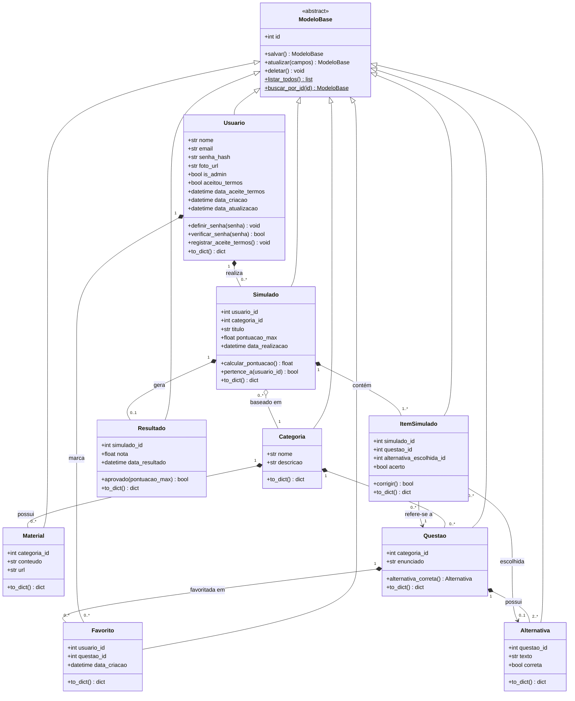

# Diagrama de classes do domínio

Classes implementadas em `backend/models/` e seus relacionamentos. O GitHub
renderiza o diagrama abaixo automaticamente (sintaxe Mermaid). O mesmo
diagrama está em [`diagrama_classes.mmd`](diagrama_classes.mmd).

## Legenda

| Símbolo | Significado | Onde aparece |
|---|---|---|
| `<\|--` | **Herança** | Todas as Models herdam de `ModeloBase` (que herda de `db.Model`) e recebem o CRUD: `salvar()`, `atualizar()`, `deletar()`, `listar_todos()` e `buscar_por_id()`. |
| `*--` | **Composição** (a parte não existe sem o todo; é apagada em cascata) | Questões/materiais da categoria, alternativas da questão, simulados e favoritos do usuário, itens e resultado do simulado. |
| `o--` | **Agregação** (relação "usa", sem posse) | O simulado é baseado em uma categoria, mas não é dono dela — por isso a categoria não pode ser excluída se já tiver simulados. |
| `-->` | **Associação** | O item do simulado aponta para a questão e para a alternativa escolhida. |

## Correspondência com o banco

| Classe | Tabela | Arquivo |
|---|---|---|
| Usuario | `usuarios` | `backend/models/usuario.py` |
| Categoria | `categorias` | `backend/models/categoria.py` |
| Material | `materiais` | `backend/models/material.py` |
| Questao | `questoes` | `backend/models/questao.py` |
| Alternativa | `alternativas` | `backend/models/alternativa.py` |
| Simulado | `simulados` | `backend/models/simulado.py` |
| ItemSimulado | `itens_simulado` | `backend/models/item_simulado.py` |
| Resultado | `resultados` | `backend/models/resultado.py` |
| Favorito | `favoritos` | `backend/models/favorito.py` |
