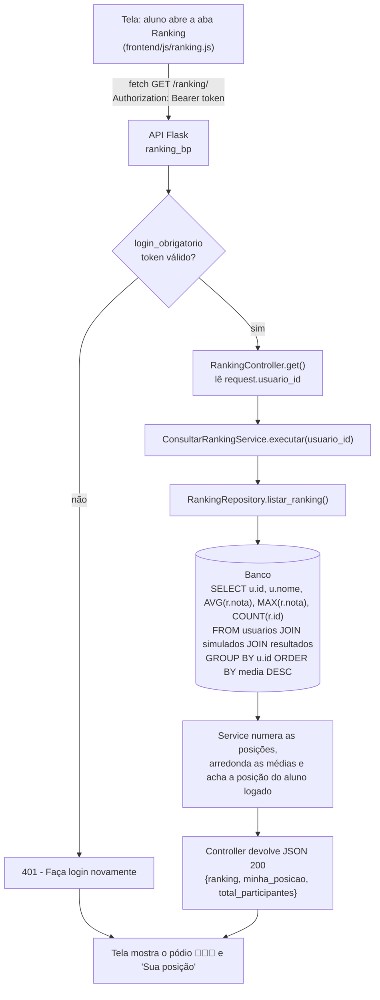
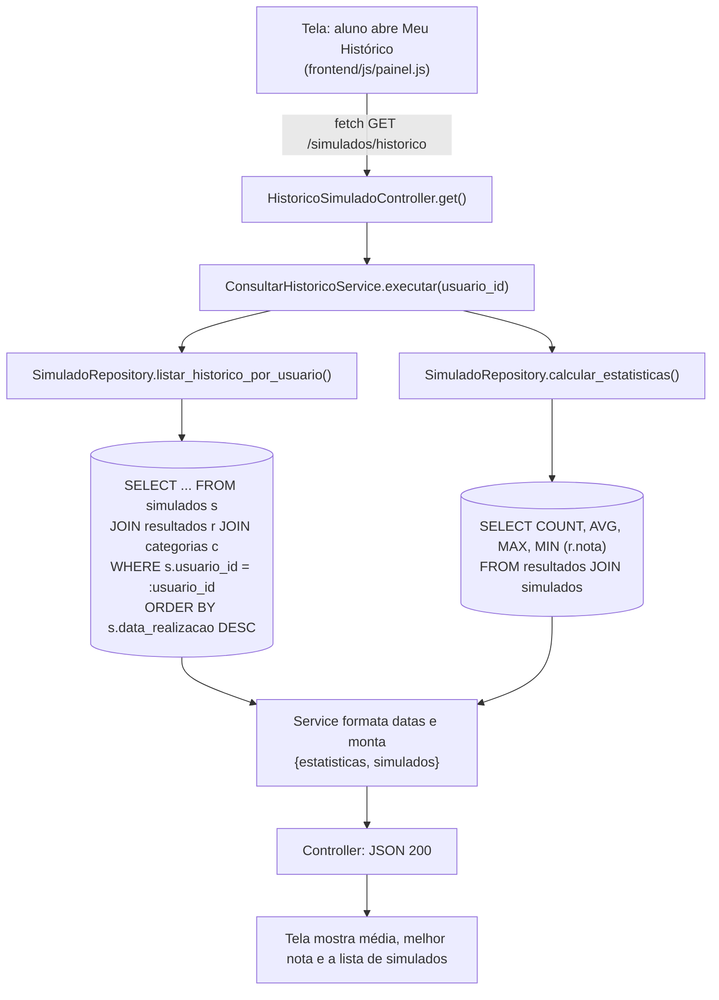
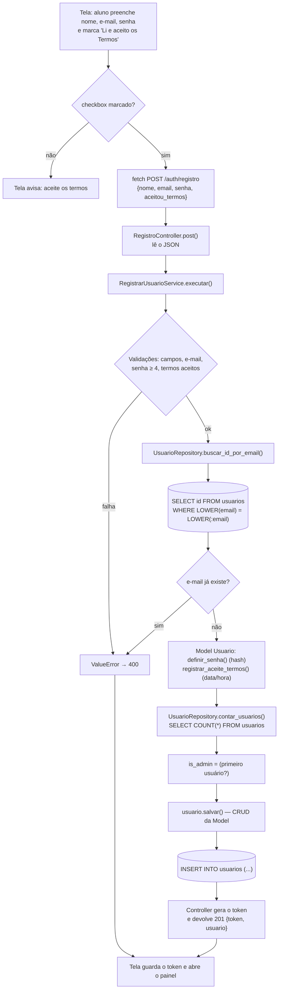
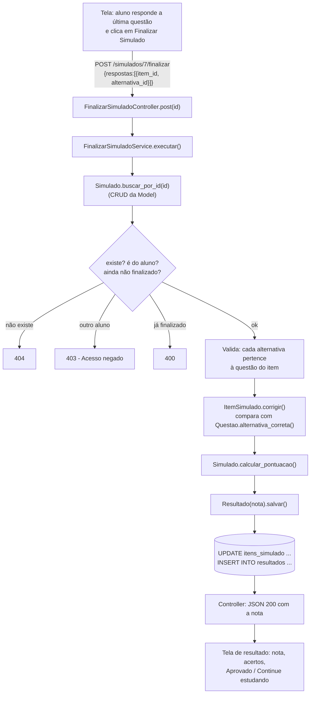

# Fluxogramas dos casos de uso

Cada fluxograma mostra o passo a passo pelas camadas:
**Tela → API Flask → Controller → Service → Model / Repository → Banco de dados**.

---

## 1. Recuperação de dados — Consultar o ranking dos alunos

Tela `painel.html` (aba 🏆 Ranking) → `GET /ranking/`

## 2. Recuperação de dados — Consultar o histórico de simulados

Tela `painel.html` (aba 📊 Meu Histórico) → `GET /simulados/historico`

---

## 3. Entrada de dados — Criar conta com aceite dos termos

Tela `index.html` (Crie sua conta) → `POST /auth/registro`

## 4. Entrada de dados — Finalizar um simulado

Tela `painel.html` (Quiz) → `POST /simulados/<id>/finalizar`

